# BarkBot



An AI agent with its own computer. You talk to it here; it works on a machine of its own, keeps going while you are away, and shows its work. Built on [Barkpark](https://github.com/FRIKKern/barkpark): Barkpark keeps the bots, the conversations and the evidence, and a stock `claude -p` on the bot's machine does the work, on the owner's own login.

[](docs/ROADMAP.md)

## How we build it

```
Grok Bot (the oracle)            BarkBot                          Barkpark
read · one gesture · read ─────► fixtures/ and traces/
                                 build one slice ── /v1/chat ───► chat host ─► claude -p
                                 gates: ours vs oracle, as numbers
                                 someone else signs the journey
```

**Recreate first** ([0005](docs/decisions/0005-recreate-first.md)): every screen, label, size and timing matches Grok Bot before we change anything. We learn it by watching ([0001](docs/decisions/0001-black-box-oracle.md)), never by copying its code, art or font files; those get plain stand-ins of the same size. "1:1" is a number three gates print ([0002](docs/decisions/0002-gates.md)). Each slice is one journey built all the way down, real Barkpark and real `claude` included; the first computer is the owner's Mac. The method in full: [BarkBot Oracle Method](https://guerrilla.barkpark.cloud/papers/barkbot-oracle-method). What gets built: [BarkBot Build Spec](https://guerrilla.barkpark.cloud/papers/barkbot-build-spec).

[](JOURNEYS.md)

## What happened

<!-- timeline:start -->
- **Today** · 26 changes
  - Gate A waits for a state's hover changes; avatar editor recaptured clean
  - Oracle: widths 720, 880, 2000; the base is re-established before a sweep
- **Yesterday** · 11 changes
  - S1: talk through Barkpark (server side, transcript, working line, composer)
  - S0 closed on the board; Gate B moves to S1 with the transcript it needs
<!-- timeline:end -->

## Where things live (one fact, one home)

| What | Where |
|---|---|
| Slices and who does what | Barkpark goal `task-e7970acf9582cad2` and its children; snapshot in `parity/board.json` |
| Every item and its status, with evidence | [`parity/items/`](parity/items/), one file per item, listed in [`docs/PARITY.md`](docs/PARITY.md) |
| The spec of "works" | [`JOURNEYS.md`](JOURNEYS.md) |
| The gates, the oracle rules, the pace rules | [`QUALITY.md`](QUALITY.md) |
| Why | [`docs/decisions/`](docs/decisions/), one page each, superseded never edited |
| Captured oracle states (numbers only) | `fixtures/states/` |
| Recorded oracle turns (order and timing only) | `traces/` |
| The app | `app/` (TanStack Start + React); Gate A and the inventory, one file per captured state, in `parity/gate-a/` |
| How we work | [`AGENTS.md`](AGENTS.md), [`CONTRIBUTING.md`](CONTRIBUTING.md) |

## Run it

```sh
npm run check    # doc caps, links, items, fresh pictures, no secrets
npm run board    # snapshot the Barkpark board (needs bp)
npm run docs     # redraw the pictures, PARITY.md and the timeline
npm run gate     # Gate A and the inventory: the app against every captured oracle state
npm run host:enroll  # once: make this Mac the bot's computer (token from Studio > Chat hosts)
npm run host         # keep running while the bot works
cd app && pnpm install && pnpm dev   # the app on http://localhost:3170
```
