# BarkBot



An AI agent with its own computer. You talk to it here; it works on a machine of its own, keeps going while you are away, and shows its work. Built on [Barkpark](https://github.com/FRIKKern/barkpark): Barkpark keeps the bots, the conversations and the evidence, and a stock `claude -p` on the bot's machine does the work, on the owner's own login.

[](docs/ROADMAP.md)

## How we build it

```
Grok Bot (the oracle)            BarkBot                          Barkpark
read · one gesture · read ─────► fixtures/ and traces/
                                 build one slice ── /v1/chat ───► chat host ─► claude -p
                                 gates: ours vs oracle, as numbers
                                 someone else signs the journey
```

**Recreate first** ([0005](docs/decisions/0005-recreate-first.md)): every screen, label, size and timing matches Grok Bot before we change anything. We learn it by watching ([0001](docs/decisions/0001-black-box-oracle.md)), never by copying its code, art or font files; those get plain stand-ins of the same size. "1:1" is a number three gates print ([0002](docs/decisions/0002-gates.md)). Each slice is one journey built all the way down, real Barkpark and real `claude` included; the first computer is the owner's Mac. The method in full: [BarkBot Oracle Method](https://guerrilla.barkpark.cloud/papers/barkbot-oracle-method). What gets built: [BarkBot Build Spec](https://guerrilla.barkpark.cloud/papers/barkbot-build-spec).

[](JOURNEYS.md)

## News

<!-- news:start -->
**Tuesday 24 November.** 4 pull requests merged. BarkBot's live status stream no longer passes on other people's conversations: only its own conversations go out, each as its id and one of four state words, so a workspace-mate's conversation id and title never reach the page. The picture viewer is now modal: Tab stays inside it, the page behind is inert, and Escape in its composer menu closes only the menu. Gate A now reports, per screen, the oracle's boxes no case scores: 3,013 over 54 screens. [The full day](docs/news/2026-11-24.md)
- **Own conversations only:** the status stream sends only our own conversations' state, a known word, and drops a revoked computer's within 10 s ([#324](https://github.com/FRIKKern/barkbot/pull/324), [#327](https://github.com/FRIKKern/barkbot/pull/327))
- **Picture viewer:** modal: Tab stays inside, the page behind is inert, Escape closes the composer menu first ([#325](https://github.com/FRIKKern/barkbot/pull/325))
- **Gate A:** a report of the oracle's boxes no case scores, 3,013 over 54 screens ([#326](https://github.com/FRIKKern/barkbot/pull/326))

**Saturday 21 November.** 5 pull requests merged, one of them Friday's News. The account menu, the Connect Apps dialog and all four Settings pages now follow Grok Bot 1.2.3, and in those four pages every measured case passes. A conversation now shows a time row above a message sent an hour or more after the one before it, or on another day, from the messages' own times. Gate A, which measures our screens against the oracle's, passed 1,977 of 2,103 cases at the day's last merge, up from 1,522. [The full day](docs/news/2026-11-21.md)
- **Menus and Settings:** the account menu in three groups; Connect Apps and the four Settings pages as in 1.2.3, several of their buttons not working yet ([#281](https://github.com/FRIKKern/barkbot/pull/281), [#280](https://github.com/FRIKKern/barkbot/pull/280))
- **Conversation:** a time row above a message an hour or more after the last, or on another day; a file card stacks two files, and the details panel stays open under 800 wide ([#297](https://github.com/FRIKKern/barkbot/pull/297), [#295](https://github.com/FRIKKern/barkbot/pull/295))
<!-- news:end -->

## Where things live (one fact, one home)

| What | Where |
|---|---|
| Slices and who does what | Barkpark goal `task-e7970acf9582cad2` and its children; snapshot in `parity/board.json` |
| Every item and its status, with evidence | [`parity/items/`](parity/items/), one file per item, listed in [`docs/PARITY.md`](docs/PARITY.md) |
| The spec of "works" | [`JOURNEYS.md`](JOURNEYS.md) |
| The gates, the oracle rules, the pace rules | [`QUALITY.md`](QUALITY.md) |
| Why | [`docs/decisions/`](docs/decisions/), one page each, superseded never edited |
| Captured oracle states (numbers only) | `fixtures/states/` |
| Recorded oracle turns (order and timing only) | `traces/` |
| The app | `app/` (TanStack Start + React); Gate A and the inventory, one file per captured state, in `parity/gate-a/` |
| How we work | [`AGENTS.md`](AGENTS.md), [`CONTRIBUTING.md`](CONTRIBUTING.md) |

## Run it

```sh
npm run check    # doc caps, links, items, fresh pictures, no secrets
npm run board    # snapshot the Barkpark board (needs bp)
npm run docs     # redraw the pictures and PARITY.md
npm run gate     # Gate A and the inventory: the app against every captured oracle state
npm run host:enroll  # once: make this Mac the bot's computer (token from Studio > Chat hosts)
npm run host         # keep running while the bot works
cd app && pnpm install && pnpm dev   # the app on http://localhost:3170
```
